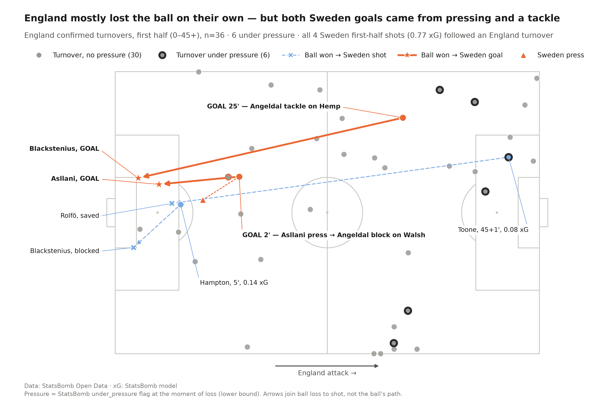
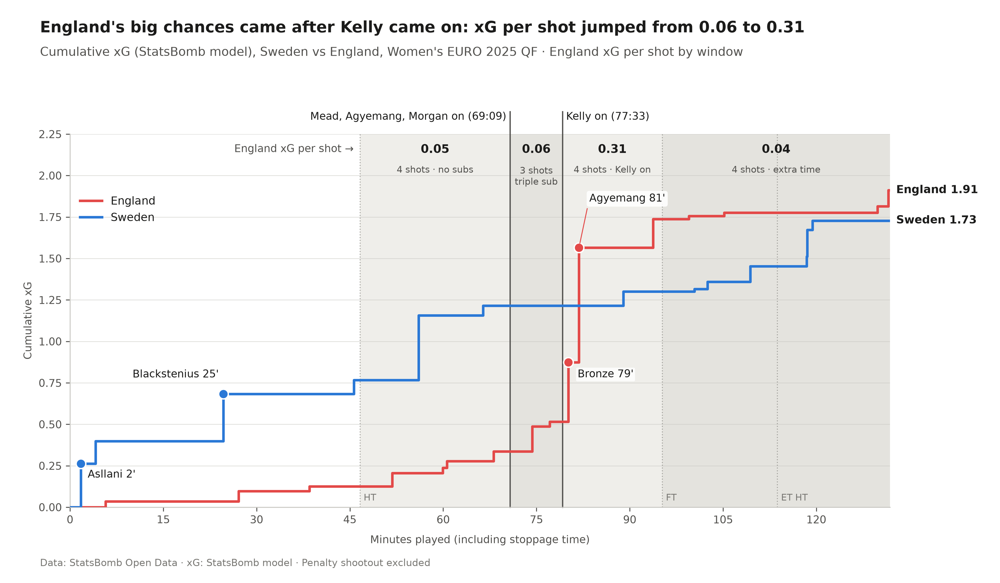
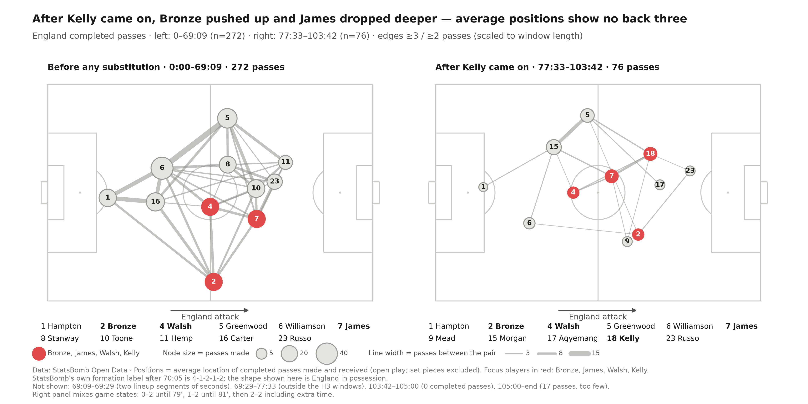
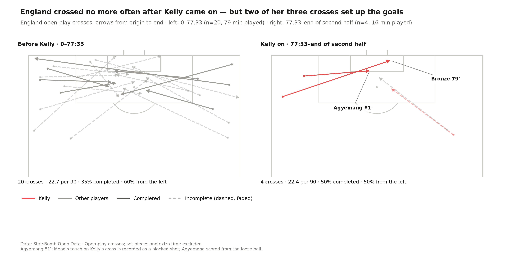
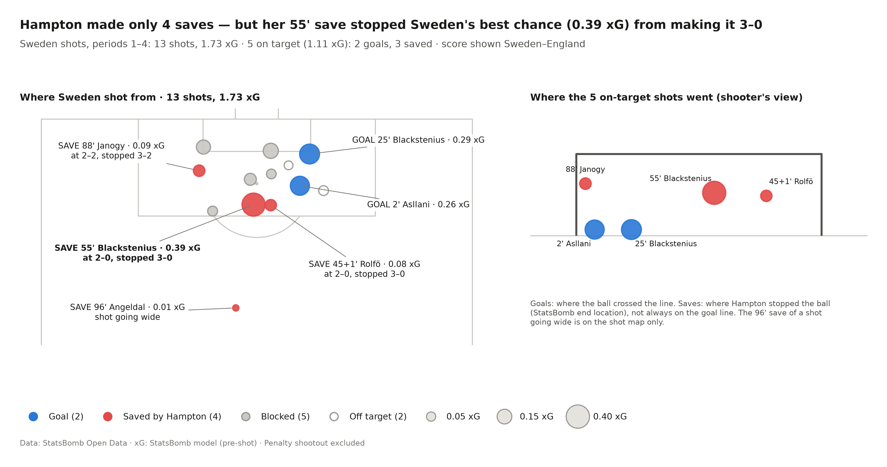
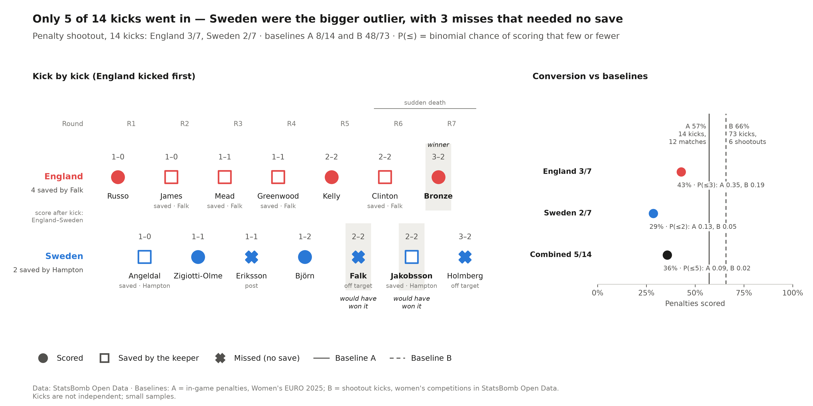

# Sweden 2–2 England (2–3 pens): a miracle or the right coaching decisions?

**UEFA Women's EURO 2025 quarter-final · 17 July 2025 · Stadion Letzigrund, Zurich**

Sweden led 2–0 after 25 minutes. England equalised with two goals in under two minutes (79', 81'), survived extra time and won a shootout in which only 5 of 14 kicks went in. This project uses StatsBomb Open Data to ask one question about that match: was England's comeback a miracle, or the result of the right coaching decisions?

## Short answer

**Both, in sequence.** Coaching decisions created the comeback. After Chloe Kelly came on at 77:33, England's xG per shot jumped from 0.06 to 0.31, and two of her three crosses led to both goals. But England only reached the semi-final because of moments the staff could not control: Hannah Hampton's save at 2–0 against Sweden's best chance of the match, and a shootout in which Sweden missed three kicks without a save.

| # | Hypothesis | Verdict |
|---|---|---|
| H1 | England lost the ball on their own; Sweden punished them | Partly: most losses were unforced, but both goals came from Swedish pressing and a tackle |
| H2 | The substitutions improved England's chances | Supported: quality jumped after Kelly came on; the triple substitution added tempo, not quality |
| H3 | England switched to a 3-4-3 | Not supported: Bronze pushed up and James dropped deeper, but average positions show no back three |
| H4 | England's crossing changed after Kelly came on | Partly: no more crosses, but two decisive deliveries |
| H5 | Hampton kept England alive | Partly: only 4 saves, but one at 2–0 stopped Sweden's best chance |
| H6 | The shootout was decided by Sweden's misses | Partly: Sweden were the bigger outlier, with 3 misses that needed no save |

## The match

| | |
|---|---|
| Score | Sweden 2–2 England (a.e.t.), 2–3 on penalties |
| Goals | Asllani 2', Blackstenius 25' · Bronze 79', Agyemang 81' |
| England substitutions | Mead, Agyemang, Morgan (69:09–69:29) · Kelly (77:33) |
| Final xG (StatsBomb, periods 1–4) | Sweden 1.73 · England 1.91 |

Scores are written Sweden–England throughout, as in the official listing.

## H1 — England mostly lost the ball on their own, but both Sweden goals came from pressing and a tackle



- England had 36 confirmed turnovers in the first half. Only 6 (17%) were under pressure, with on average 0.9 Sweden players within 5 yards (360 data).
- All 4 of Sweden's first-half shots (0.77 xG) followed an England turnover.
- **2' goal:** Asllani pressed Carter, Angeldal blocked Walsh's pass, Blackstenius recovered and Asllani scored, 11.8 seconds after the move started.
- **25' goal:** after a Sweden throw-in, Angeldal tackled Hemp and Sweden scored within seconds.

**Verdict: partly supported.** England's build-up was loose, but Sweden's pressing was selective and decisive. Angeldal was at the start of both goals.

## H2 — England's big chances came after Kelly came on



England's xG per shot by window, all starting with Sweden 2–0 up except extra time (2–2):

| Window | Shots | xG per shot |
|---|---|---|
| 45:00–69:09, no substitutions | 4 | 0.05 |
| 69:09–77:33, triple substitution | 3 | 0.06 |
| 77:33–end of 2nd half, Kelly on | 4 | 0.31 |
| Extra time | 4 | 0.04 |

- The triple substitution raised England's tempo (xG per 90 more than doubled) but not the quality of each shot.
- The quality jump came after Kelly came on. Mead and Agyemang, from the triple substitution, were both involved in the second goal.
- The effect did not last: in extra time Sweden created 0.43 xG to England's 0.17.

**Verdict: supported,** with a small sample (3–4 shots per window).

## H3 — Did England switch to a 3-4-3?



[Tactical analysis (Coaches' Voice)](https://learning.coachesvoice.com/cv/sweden-england-euro-2025-tactical-analysis/) described England's comeback shape as a 3-4-3 in possession. Pass networks before any substitution (0–69:09, 272 passes) and after Kelly came on (77:33–103:42, 76 passes) show:

- Bronze moved 13.5 yards higher and much narrower (24.5 yards from the touchline instead of 7).
- James dropped 12 yards deeper, but stayed 14 yards ahead of Walsh, not beside her.
- Kelly was not England's main outlet: she received 10 of 76 passes, third among outfield players.
- Average positions show no back three after Kelly came on.

**Verdict: not supported** as a 3-4-3. Bronze's and James's roles did change. Caveats: the second window mixes game states (2–0 until 79', then 2–1 and 2–2), and average positions hide shapes that form only in moments. With positions based on passes made only, a back-three-like shape appears *before* the substitutions, not after.

## H4 — England crossed no more often after Kelly came on, but two of her three crosses set up the goals



| | Before Kelly (0–77:33) | Kelly on (77:33–end of 2nd half) |
|---|---|---|
| Open-play crosses | 20 (22.7 per 90) | 4 (22.4 per 90) |
| Completed | 7 of 20 | 2 of 4 |
| By Kelly | 0 | 3 |
| Led to a shot | 2 | 2, both goals |

- 79': Kelly's cross, Bronze's header.
- 81': Kelly's cross, Mead's header was blocked and Agyemang scored from the rebound, so StatsBomb credits no assist.

**Verdict: partly supported.** The crossing volume did not change; two decisive deliveries did. Two events are an observation, not a pattern.

## H5 — Hampton made only 4 saves, but one of them kept the comeback possible



- Sweden had 13 shots (1.73 xG); 5 were on target (1.11 xG): 2 goals, 3 saves. Hampton also saved one shot that was going wide.
- By volume, the case is weak: 4 saves worth 0.57 xG, while 2 of 5 on-target shots (1.11 xG) went in. Open data has no post-shot xG, so save difficulty cannot be measured.
- By timing, it holds: at 55', with Sweden 2–0 up, Hampton saved Blackstenius's 0.39 xG chance, Sweden's best of the match. A third goal at 55' would have left England needing three goals to draw. She also saved at 45+1' (2–0) and 88' (2–2).
- For balance: Hampton's miscontrol at 5' led to a Sweden shot (see H1).

**Verdict: partly supported** — the case rests on timing, not volume.

## H6 — The shootout: Sweden were the bigger outlier



- Only 5 of 14 kicks went in. Kick order and outcomes match the ESPN match report (14 of 14).
- England 3 of 7: all four failures were saved by Falk.
- Sweden 2 of 7: two saved by Hampton, three missed with no save. Two of Sweden's kicks (Falk, Jakobsson) would have won the shootout.

| | Scored | P(this few or fewer), baseline A | baseline B |
|---|---|---|---|
| England | 3/7 | 0.35 | 0.19 |
| Sweden | 2/7 | 0.13 | 0.05 |
| Combined | 5/14 | 0.09 | 0.02 |

Baseline A: in-game penalties at Women's EURO 2025 (8 of 14, 57%). Baseline B: shootout kicks in women's competitions in StatsBomb Open Data (48 of 73, 66%, 6 shootouts).

**Verdict: partly supported.** The data cannot separate luck from skill, so the verdict is about where the outlier was: Sweden's finishing, not England's.

## Conclusion

The comeback was built by decisions: the substitutions changed the quality of England's chances, and Kelly's deliveries produced both goals. But it only became a win because of moments outside the staff's control: one save at 2–0 and a shootout that Sweden lost twice from winning positions. The miracle was not that England came back — it was that they were still alive to do it.

## Limitations

- **One match.** Every finding describes this game, not a general rule.
- **Small samples.** 3–4 shots per xG window, 4 crosses after Kelly came on, 14 shootout kicks and small baselines.
- **xG model.** StatsBomb's xG differs from Opta and UEFA figures published elsewhere. Open data has pre-shot xG only, no post-shot xG, so save difficulty cannot be measured.
- **Pressure.** StatsBomb's `under_pressure` flag is set only on the event where the ball is lost, so 17% is a lower bound.
- **Average positions** blur shapes that form only in moments, and the H3 result depends on the method.
- **Event data errors.** StatsBomb's tagging is not perfect, which is why key moments were checked against video (below).

## Validation

- Notebook 01 checks the data against known facts: goal minutes and scorers, the final score, substitutions and the shootout.
- One check is flagged rather than forced: Kelly's substitution is listed as 77' in some reports and 78' in others; the data has 77:33. This is a clock-convention difference, not a data error.
- **Video:** the 2' Sweden goal and the 81' England goal were checked frame by frame. Both match the event data; video confirmed that Angeldal (no. 16), not Asllani, blocked Walsh's pass.
- **Press:** the shootout kick order matches the ESPN match report (14 of 14).

## Data and tools

- [StatsBomb Open Data](https://github.com/statsbomb/open-data), Women's EURO 2025 (competition_id 53, season_id 315), event and 360 data, loaded with [statsbombpy](https://github.com/statsbomb/statsbombpy).
- Python, pandas, matplotlib, [mplsoccer](https://github.com/andrewRowlinson/mplsoccer).
- Built with Claude Code as a coding assistant, following the rules in [CLAUDE.md](CLAUDE.md): every number in a chart is read from the data, and every chart has built-in checks that stop the run if they fail.

## Project structure

```
├── notebooks/
│   ├── 01_data_loading.ipynb    loading and validation against known facts
│   ├── 02_analysis_prep.ipynb   tables for each hypothesis
│   └── 03_figures.ipynb         charts with built-in checks
├── src/
│   ├── data.py                  loading, caching, time windows
│   └── plots.py                 shared style and team colours
├── figures/                     the six charts
├── CLAUDE.md                    project rules for the AI assistant
└── requirements.txt
```

## How to run

```bash
python -m venv .venv
source .venv/bin/activate
pip install -r requirements.txt
jupyter nbconvert --to notebook --execute --inplace notebooks/01_data_loading.ipynb
jupyter nbconvert --to notebook --execute --inplace notebooks/02_analysis_prep.ipynb
jupyter nbconvert --to notebook --execute --inplace notebooks/03_figures.ipynb
```

Data is downloaded and cached on the first run (data/ is not tracked by git).

---

Data: StatsBomb Open Data.

<!-- TODO: add the StatsBomb logo from their Media Pack here -->
